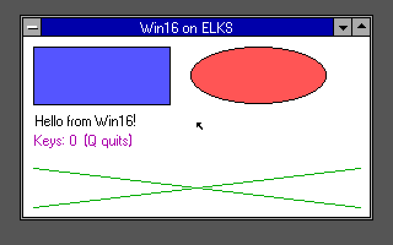

<div align="center">

# w16 for ELKS

**Win16 applications on ELKS: 640×480 experimental VGA and 320×200 Tandy/PCjr graphics, in 16 colours.**

Run selected Windows programs on an 8086-class ELKS guest without running Windows. Choose the display build that matches the machine.

<a href="docs/screenshots/paintbrush-elks-logo-qemu-vga.png"></a>

**Windows 3.0 Paintbrush on ELKS · 640×480 VGA · QEMU**

The logo was drawn with Paintbrush’s line tool using emulated mouse input. This is an emulator capture, not a physical-hardware test. Paintbrush support is experimental: this drawing does not establish that every tool or file operation works.

[Experimental VGA setup](docs/build.md#experimental-vga-solitaire) · [Tandy/PCjr setup](docs/build.md#3-build-nano-x-and-w16) · [Screenshots](docs/gallery.md) · [Technical guide](docs/technical.md) · [MIT license](LICENSE)

</div>

<table>
  <tr>
    <td width="50%"><a href="docs/screenshots/reversi-board-after-moves-martypc-8088-framebuffer.png"></a></td>
    <td width="50%"><a href="docs/screenshots/clock-martypc-8088-analog-framebuffer.png"></a></td>
  </tr>
  <tr>
    <td align="center"><b>Reversi</b> · MartyPC, emulated 8088</td>
    <td align="center"><b>Clock</b> · MartyPC, emulated 8088</td>
  </tr>
</table>

`w16` loads a Windows NE executable, binds its supported Win16 imports to native handlers, and runs its code on ELKS. The Windows 3.0 examples use unchanged application executables; Windows 3.1 Minesweeper needs a converted private copy. Nano-X supplies display and input. No Microsoft executables or system files are included.

The supported programs and display configurations are listed below. This is not a general-purpose Windows compatibility environment.

## What runs

| Program | Working features | Where to get it |
| :--- | :--- | :--- |
| **HELLO16** | Drawing, colours, text, mouse and keyboard input | [Source included](test/hello16) |
| **DLGTEST** | Modal dialogs, resources, buttons, menus and string tables | [Source included](test/dlgtest) |
| **MBTEST** | Message boxes, icons and button results | [Source included](test/mbtest) |
| **Windows 3.1 Minesweeper** | Reveal cells, flag them and change board size on emulated 8086 | Bring your own supported WINMINE.EXE; convert a private copy as below |
| **Windows 3.0 Paintbrush** | Line drawing in colour; opens indexed BMPs on the experimental VGA configuration | Bring your own EXE and companion DLL |
| **Windows 3.0 WINVER** | Version dialog | Bring your own copy |
| **Windows 3.0 CLOCK** | Analog/digital display, timer, Settings menu, About and WIN.INI preferences | Bring your own copy |
| **Windows 3.0 REVERSI** | Play against the computer, menus, hints, cursors, accelerators and About | Bring your own copy |
| **Windows 3.0 SOLITAIRE** | Stock dealing, basic tableau moves, and Game → Options in the [experimental VGA build](docs/build.md#experimental-vga-solitaire) | Bring your own copy |

### Display configurations

| Display build | Resolution | Emulator coverage |
| :--- | :--- | :--- |
| **Experimental VGA** | 640×480, 16 colours | Paintbrush and Solitaire in QEMU; converted Minesweeper in QEMU and DOSBox-X 8086 mode |
| **Tandy / expanded PCjr** | 320×200, 16 colours | Tandy in 86Box and MartyPC; expanded PCjr in DOSBox-X |

A result on one display is not a claim about the others. Physical hardware and original-machine performance have not been verified. See the [technical guide](docs/technical.md#patch-internals-and-emulator-measurements) for the test configurations.


<table>
  <tr>
    <td width="50%"><a href="docs/screenshots/hello16-colors-text-dosboxx-pcjr.png"></a></td>
    <td width="50%"><a href="docs/screenshots/messagebox-question-icon-86box-8088.png"></a></td>
  </tr>
  <tr>
    <td align="center"><b>HELLO16</b> · DOSBox-X, emulated PCjr</td>
    <td align="center"><b>MBTEST</b> · 86Box, emulated 8088</td>
  </tr>
</table>

[See the gallery →](docs/gallery.md) for VGA Solitaire, Clock and Reversi, and the Tandy/PCjr examples.

## Running the Windows 3.1 Minesweeper on an 8086-class guest

Unlike the Windows 3.0 examples, this game's original code contains instructions introduced after the 8088. On the build host, install NASM's `ndisasm` on your PATH and run:

```sh
python3 tools/winmine8088.py /path/to/original/WINMINE.EXE /tmp/mine8086.exe
```

The output path must not already exist. Copy that private output into your ELKS guest, start the patched VGA Nano-X server and run `w16 /path/to/mine8086.exe`. Use a writable working directory if you want settings saved to `winmine.ini`. No Microsoft executable is distributed here. The transformer targets a specific two-segment layout, not arbitrary Windows programs.

The converted game has run on ELKS in DOSBox-X's 8086 CPU mode. Mouse input revealed numbered squares and placed flags; the Game menu switched to an Intermediate board. This does not establish physical 8088 compatibility, original clock speed, or complete coverage of every game path. The legacy sound service reports no voices. The compact build retains API call tracing (`-t`) and error messages but omits detailed verbose logging and the allocation census to fit its two code segments.

## Solitaire on experimental VGA

[](docs/gallery.md#solitaire-on-experimental-vga)

The separately supplied Windows 3.0 executable runs in QEMU. Stock dealing, basic tableau moves, and Options have been tested; a full game and real hardware have not. See the [VGA setup and limitations](docs/build.md#experimental-vga-solitaire).

## Build it from source

Start with the **[build and run guide](docs/build.md)**. You will need:

- An **ELKS 0.9.2** source tree and its **ia16** cross toolchain. The public [Tandy branch](https://github.com/astrobleem/elks/tree/tandy-video-v0.9.2) and [PCjr branch](https://github.com/astrobleem/elks/tree/pcjr-video-v0.9.2) provide support for those two targets. For VGA, use an ELKS kernel configured for VGA and medium-model executables as described in the [VGA setup](docs/build.md#experimental-vga-solitaire).
- **Microwindows/Nano-X**, with the Tandy/PCjr base patch and the two Nano-X patches included here. The client library must use the **medium memory model**.
- **Open Watcom v2** to build the included Win16 examples. No Windows SDK, DDK or Windows media is needed for those examples.
- A Linux build host with Make, GCC, Python 3, Git and `patch`.

With ELKS and the patched Microwindows tree prepared, set the paths for either display build:

```bash
# From this repository's root. Use absolute paths for both trees.
export TOPDIR=/path/to/elks
export MWDIR=/path/to/microwindows
. "$TOPDIR/env.sh"
```

**For experimental VGA (640×480)**, build the matching server and client library in a separate output directory:

```sh
export VGA_OUT="$PWD/build/nanox-vga"
sh scripts/build-nanox-vga.sh
make -C src clean
make -C src TOPDIR="$TOPDIR" MWDIR="$VGA_OUT"
```

Copy `$VGA_OUT/nano-x` and `src/w16` to the VGA guest. Start `nano-x -p &` there before launching the application. Keep this server and its matching client library together: VGA screen capture and pixel readback use negotiated extensions.

**For Tandy/PCjr (320×200)**, use the standard target-specific server:

```sh
sh scripts/build-nanox.sh
make -C src clean
make -C src TOPDIR="$TOPDIR" MWDIR="$MWDIR"
```

On that guest, start `nano-color -p &`. For either target, `WATCOM=/path/to/open-watcom make samples` builds the source examples; copy the sample to the guest and run `w16 hello16.exe`. See the [build guide](docs/build.md) for kernel, input and disk-image setup.

With your own Windows 3.0 programs on the ELKS disk:

```sh
W16INI=/root/win.ini w16 clock.exe
w16 reversi.exe
```

For the experimental VGA Paintbrush setup shown above, put your own Windows 3.0 `pbrush.exe` and `pbrush.dll` in the working directory:

```sh
w16 -u -l PBRUSH=pbrush.dll pbrush.exe
```

`-l` binds the companion DLL explicitly. `-u` permits startup with unresolved imports; calling one stops the program rather than pretending the operation succeeded.

`-p` keeps Nano-X running between programs. Run one Win16 application at a time. The [keyboard patches](docs/build.md#2-prepare-elks) enable shortcuts such as Alt+F4 and Alt+Space; the system-menu Close command is also available with the mouse.

## How it fits together

1. **Load the NE file.** Validate its segments and imports, allocate real-mode memory, and apply relocations.
2. **Bridge the Win16 calls.** 8086 assembly thunks switch between the application's stack and native ELKS handlers, including callbacks into the application.
3. **Draw through Nano-X.** USER handles windows, messages, menus and dialogs; GDI maps drawing to the Nano-X display, including 320×200 Tandy/PCjr and 640×480 VGA configurations.

The implementation includes local memory and resource handling, timers, accelerators, cursors, WIN.INI access and a subset of KERNEL/USER/GDI. See [how it works](docs/technical.md#how-it-works) and the [API list](docs/technical.md#what-is-supported) for the details.

## Know the limits

- **Real mode, 8086/8088 code only.** Protected-mode-only and 80286-flagged executables, 64 KB segments and general-purpose DLL loading are unsupported. The Paintbrush example uses an explicitly bound companion DLL.
- **A small Win16 API subset.** Many applications require APIs that are not implemented. By default, unsupported imports are reported before the application starts.
- **Basic UI and graphics.** Bitmap transfers, indexed image formats, editable text and file-dialog lists cover the exercised cases, not the full Windows APIs. Modeless dialogs and full window management remain unsupported. The system menu implements Close only.
- **Conventional memory matters.** The entire application must fit; memory is not discarded or moved. Only one Win16 program can run at a time.
- **Emulation is not hardware validation.** In particular, the DOSBox-X PCjr runs use a fast fixed-cycle configuration and do not establish real-PCjr performance.

The full [limitations list](docs/technical.md#what-is-not-yet) is the best place to check before trying another program. `tools/w16census.py` can inspect an NE executable's imports, resources and memory needs.

## Explore the repository

| Path | Contents |
| :--- | :--- |
| [`src/`](src) | NE loader, Win16 API implementations and 8086 call thunks |
| [`test/`](test) | Source-built Win16 example applications |
| [`tests/`](tests) | Host loader checks, malformed inputs, keyboard checks and ELKS emulator drivers |
| [`tools/`](tools) | NE inspection, disassembly and import-coverage tools |
| [`dependencies/`](dependencies) · [`patches/`](patches) | Nano-X base patch and license; experimental VGA capture and pixel extensions |
| [`docs/`](docs) | Build guide, implementation details and real emulator captures |

For the host loader checks:

```sh
WATCOM=/path/to/open-watcom make test
```

This builds the examples and checks the host-side loader and resources, **not execution of 16-bit code**. Optional checks need an ELKS or Microwindows tree; the [build guide](docs/build.md#host-side-checks) explains the prerequisites and skipped sections.

## License

The `w16` implementation and source examples are under the [MIT license](LICENSE). Patches to ELKS and Microwindows retain their [upstream licenses](dependencies/README.md). Open Watcom also has its own license.

The screenshots show prior emulator runs with the source examples and separately supplied Windows 3.0 applications. Microsoft Windows binaries are **not distributed** in this repository.
