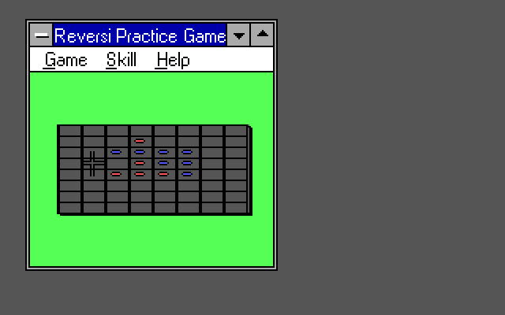
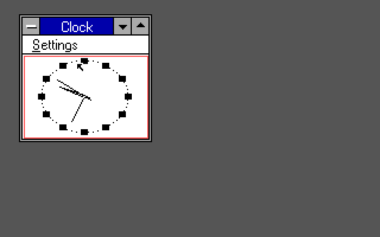
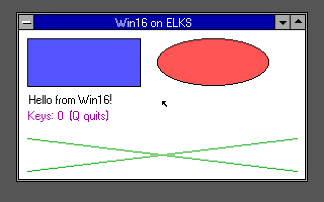
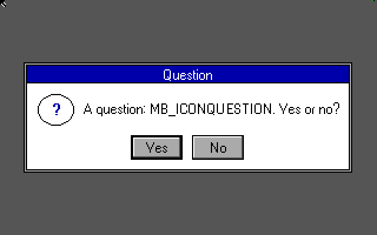

<div align="center">

# w16 for ELKS

**Windows 3.0 applications on ELKS, in 16 colours.**

An experimental Win16 compatibility layer for the 8086/8088, with Nano-X graphics for Tandy and PCjr.

[Get started](docs/build.md) · [Screenshots](docs/gallery.md) · [Technical guide](docs/technical.md) · [MIT license](LICENSE)

</div>

<table>
  <tr>
    <td width="50%"><a href="docs/screenshots/reversi-board-after-moves-martypc-8088-framebuffer.png"></a></td>
    <td width="50%"><a href="docs/screenshots/clock-martypc-8088-analog-framebuffer.png"></a></td>
  </tr>
  <tr>
    <td align="center"><b>Reversi</b> · MartyPC, emulated 8088</td>
    <td align="center"><b>Clock</b> · MartyPC, emulated 8088</td>
  </tr>
</table>

`w16` loads an **unchanged Windows NE executable**, resolves its KERNEL, USER and GDI imports to native implementations, and runs its own 8086 code on ELKS. Nano-X supplies the display and input. Windows itself is not running, and no Windows executables or system files are included.

The project is deliberately small in scope. It runs the source-built examples here and a handful of Windows 3.0 applications; **it is not a general-purpose Windows compatibility environment**.

## What runs

| Program | Working features | Where to get it |
| :--- | :--- | :--- |
| **HELLO16** | Drawing, colours, text, mouse and keyboard input | [Source included](test/hello16) |
| **DLGTEST** | Modal dialogs, resources, buttons, menus and string tables | [Source included](test/dlgtest) |
| **MBTEST** | Message boxes, icons and button results | [Source included](test/mbtest) |
| **Windows 3.0 WINVER** | Version dialog | Bring your own copy |
| **Windows 3.0 CLOCK** | Analog/digital display, timer, Settings menu, About and WIN.INI preferences | Bring your own copy |
| **Windows 3.0 REVERSI** | Play against the computer, menus, hints, cursors, accelerators and About | Bring your own copy |

These results come from emulator runs. Tandy configurations have been exercised in **86Box and MartyPC**; the expanded-PCjr configuration has been exercised in **DOSBox-X**. **No physical Tandy or PCjr validation is claimed.** The [technical guide](docs/technical.md#patch-internals-and-emulator-measurements) explains the configurations, timings and memory limits.

<table>
  <tr>
    <td width="50%"><a href="docs/screenshots/hello16-colors-text-dosboxx-pcjr.png"></a></td>
    <td width="50%"><a href="docs/screenshots/messagebox-question-icon-86box-8088.png"></a></td>
  </tr>
  <tr>
    <td align="center"><b>HELLO16</b> · DOSBox-X, emulated PCjr</td>
    <td align="center"><b>MBTEST</b> · 86Box, emulated 8088</td>
  </tr>
</table>

[See the gallery →](docs/gallery.md) for digital Clock, system menus, Reversi dialogs and the PCjr display.

## Build it from source

Start with the **[build and run guide](docs/build.md)**. You will need:

- An **ELKS 0.9.2** source tree and its **ia16** cross toolchain. The public [Tandy branch](https://github.com/astrobleem/elks/tree/tandy-video-v0.9.2) and [PCjr branch](https://github.com/astrobleem/elks/tree/pcjr-video-v0.9.2) provide the target-specific support.
- **Microwindows/Nano-X**, with the Tandy/PCjr base patch and the two Nano-X patches included here. The client library must use the **medium memory model**.
- **Open Watcom v2** to build the included Win16 examples. No Windows SDK, DDK or Windows media is needed for those examples.
- A Linux build host with Make, GCC, Python 3, Git and `patch`.

With ELKS and the patched Microwindows tree prepared:

```bash
# From this repository's root. Use absolute paths for both trees.
export TOPDIR=/path/to/elks
export MWDIR=/path/to/microwindows
. "$TOPDIR/env.sh"
sh scripts/build-nanox.sh
make -C src TOPDIR="$TOPDIR" MWDIR="$MWDIR"

WATCOM=/path/to/open-watcom make samples
```

The helper builds Nano-X and keeps separate small- and medium-model client libraries. The outputs include `src/w16` (an ELKS executable) and the example `.EXE` files. Copy them and the matching Nano-X server to your ELKS system as described in the guide. On ELKS, with the graphics-enabled kernel:

```sh
nano-color -p &
w16 hello16.exe
```

With your own Windows 3.0 programs on the ELKS disk:

```sh
W16INI=/root/win.ini w16 clock.exe
w16 reversi.exe
```

`-p` keeps Nano-X running between programs. Run one Win16 application at a time. The [keyboard patches](docs/build.md#2-prepare-elks) enable shortcuts such as Alt+F4 and Alt+Space; the system-menu Close command is also available with the mouse.

## How it fits together

1. **Load the NE file.** Validate its segments and imports, allocate real-mode memory, and apply relocations.
2. **Bridge the Win16 calls.** 8086 assembly thunks switch between the application's stack and native ELKS handlers, including callbacks into the application.
3. **Draw through Nano-X.** USER handles windows, messages, menus and dialogs; GDI maps drawing to the 320×200, 16-colour display.

The implementation includes local memory and resource handling, timers, accelerators, cursors, WIN.INI access and a subset of KERNEL/USER/GDI. See [how it works](docs/technical.md#how-it-works) and the [API list](docs/technical.md#what-is-supported) for the details.

## Know the limits

- **Real mode, 8086/8088 code only.** Protected-mode-only and 80286-flagged executables, 64 KB segments and DLL loading are unsupported.
- **A small Win16 API subset.** Many applications require APIs that are not implemented. Unsupported imports are reported before the application starts.
- **Basic UI and graphics.** No general `BitBlt`, bitmap-resource support, editable text fields, list boxes, modeless dialogs or full window management. The system menu implements Close only.
- **Conventional memory matters.** The entire application must fit; memory is not discarded or moved. Only one Win16 program can run at a time.
- **Emulation is not hardware validation.** In particular, the DOSBox-X PCjr runs use a fast fixed-cycle configuration and do not establish real-PCjr performance.

The full [limitations list](docs/technical.md#what-is-not-yet) is the best place to check before trying another program. `tools/w16census.py` can inspect an NE executable's imports, resources and memory needs.

## Explore the repository

| Path | Contents |
| :--- | :--- |
| [`src/`](src) | NE loader, Win16 API implementations and 8086 call thunks |
| [`test/`](test) | Source-built Win16 example applications |
| [`tests/`](tests) | Host loader checks, malformed inputs, keyboard checks and ELKS emulator drivers |
| [`tools/`](tools) | NE inspection, disassembly and import-coverage tools |
| [`dependencies/`](dependencies) | Tandy/PCjr Nano-X base patch and its license |
| [`docs/`](docs) | Build guide, implementation details and real emulator captures |

For the host loader checks:

```sh
WATCOM=/path/to/open-watcom make test
```

This builds the examples and checks the host-side loader and resources, **not execution of 16-bit code**. Optional checks need an ELKS or Microwindows tree; the [build guide](docs/build.md#host-side-checks) explains the prerequisites and skipped sections.

## License

The `w16` implementation and source examples are under the [MIT license](LICENSE). Patches to ELKS and Microwindows retain their [upstream licenses](dependencies/README.md). Open Watcom also has its own license.

The screenshots show prior emulator runs with the source examples and separately supplied Windows 3.0 applications. Microsoft Windows binaries are **not distributed** in this repository.
