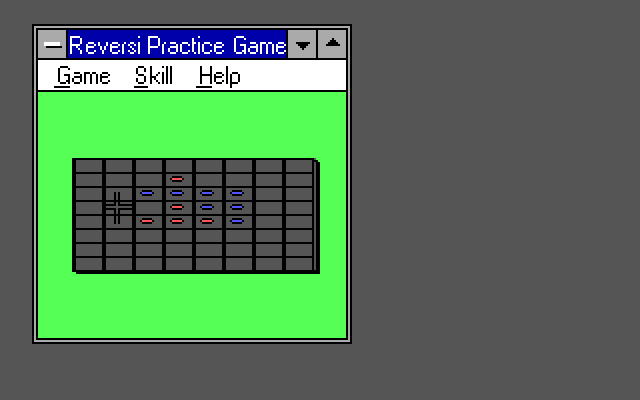
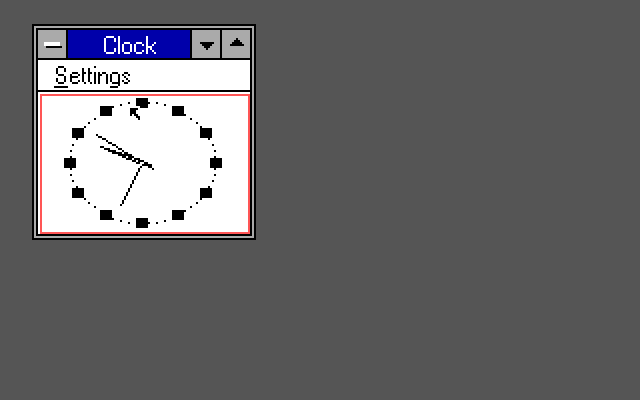
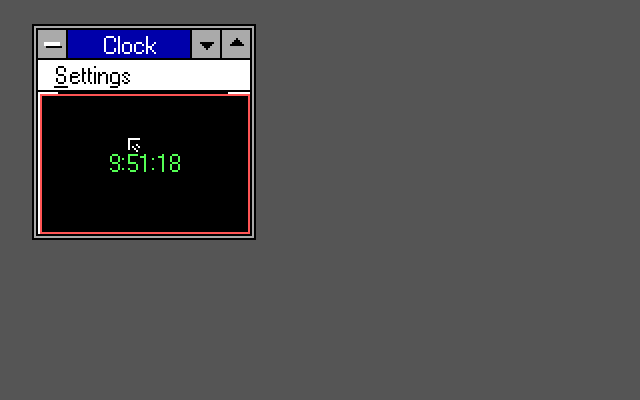
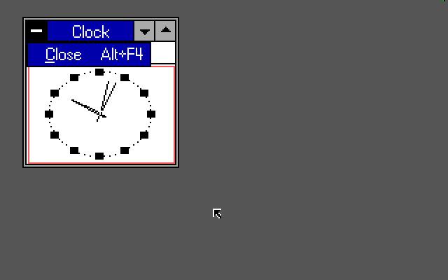
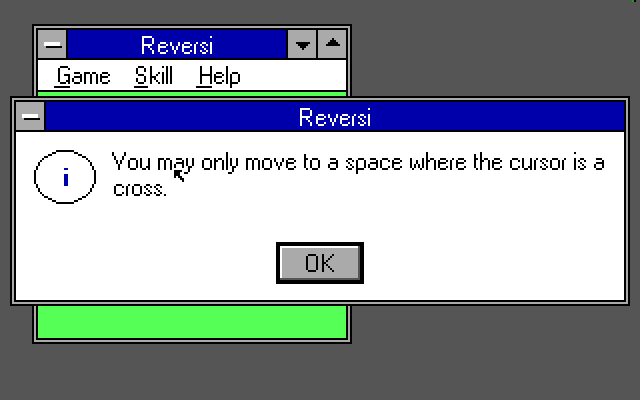
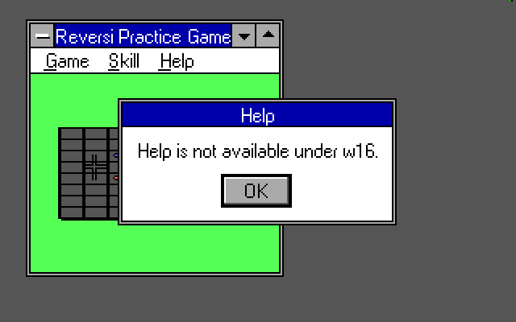
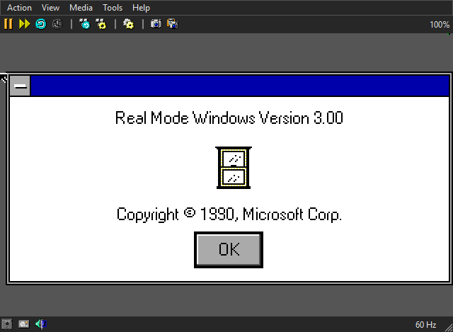
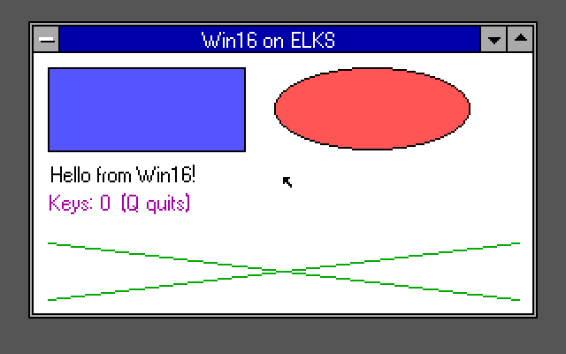
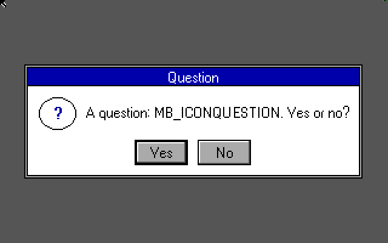
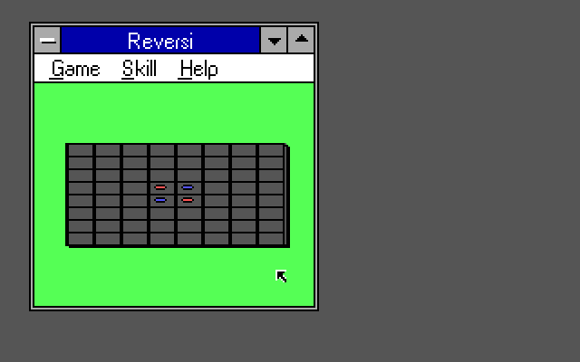

# Screenshot gallery

[← Project overview](../README.md) · [Build and run](build.md) · [Technical guide](technical.md)

Actual captures from prior emulator runs of `w16` on ELKS. Images are kept as supplied, with no invented UI or composited application windows. Click an image to view the full capture.

The display target is 320×200 with 16 colours; these captures are displayed at 640×400, or include emulator window controls. All machines shown below are **emulated**. These images do not establish physical-hardware compatibility or performance.

## Windows 3.0 applications

### Reversi after several moves

**MartyPC · emulated 8088 · framebuffer capture.** The original Windows 3.0 application runs its own game logic, including the computer opponent and hints.

### Clock, analog and digital

<table>
  <tr>
    <td width="50%"></td>
    <td width="50%"></td>
  </tr>
  <tr><td align="center">Analog</td><td align="center">Digital</td></tr>
</table>

**MartyPC · emulated 8088 · framebuffer captures.** Clock uses timers, its Settings menu and WIN.INI preferences. All requested fonts currently use the Nano-X system font.

### The system menu

**86Box · emulated 8088.** Alt+Space opens the system menu with the supplied keyboard patches. Close is implemented; moving, resizing, minimizing and maximizing are not.

### Reversi dialogs

<table>
  <tr>
    <td width="50%"></td>
    <td width="50%"></td>
  </tr>
  <tr><td align="center">Move guidance</td><td align="center">Help fallback</td></tr>
</table>

**86Box · emulated 8088.** Message boxes are modal. There is no Windows Help viewer: Help requests display a short explanation instead. The Help capture uses the corrected Nano-X server, without the earlier cursor-redraw defect.

### WINVER

**86Box · emulated 8088 · capture includes emulator controls.** This is the Windows application's own version dialog running under `w16`; it does not mean a Windows operating system is running underneath.

## Source-built examples

### HELLO16 on the PCjr configuration

**DOSBox-X · emulated PCjr.** The example's [complete source](../test/hello16) is included and builds with Open Watcom v2, without Windows media.

### MBTEST message box

**86Box · emulated 8088.** The [MBTEST source](../test/mbtest) exercises message boxes, drawn icons and button results.

## Expanded-PCjr display

**DOSBox-X · `machine=pcjr` · 640 KB.** The prior runs used an 8086 core at a fixed 8000 cycles with DOSBox-X's own PCjr BIOS. This is much faster than an original PCjr and is not a real-PCjr performance result. See the [technical notes](technical.md#patch-internals-and-emulator-measurements).

---

Windows applications shown here were supplied separately. This repository contains their screenshots, not their executable files. Use your own copies to reproduce those runs, or start with the included source examples.
